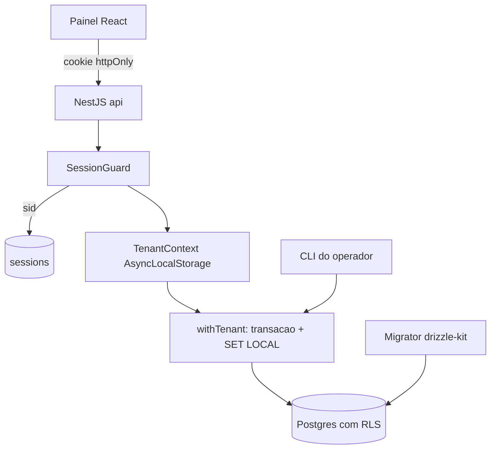

# M0 — Fundação: Design

**Spec:** `.specs/features/foundation/spec.md`
**Status:** Draft
**Data:** 2026-09-05

---

## Visão geral

O M0 entrega três coisas que todo o resto do sistema herda: um ambiente que sobe por um comando, um esquema em que o isolamento de tenant é imposto pelo Postgres, e uma sessão autenticada que carrega o tenant ativo do cookie até a policy de RLS.

A espinha dorsal do design é uma cadeia única e obrigatória:

```
cookie de sessão → sessão no banco → membership → tenant ativo
    → transação com SET LOCAL app.tenant_id → policy de RLS → linhas visíveis
```

Nenhum acesso a dado de tenant existe fora dessa cadeia. Não há caminho alternativo ao repositório, nem query fora de transação com contexto — é o que torna o isolamento uma propriedade estrutural em vez de disciplina de quem escreve query.



---

## Estrutura do monorepo

Fecha o todo aberto em STATE.md ("definir a estrutura do monorepo na Fase 0"). Fronteiras desenhadas para os milestones seguintes: `db` e `core` não conhecem HTTP; `api` é apenas a casca de entrega.

```
orquestra/
├── apps/
│   ├── api/                  # NestJS — api, worker e scheduler (mesma imagem, papéis por env)
│   └── web/                  # React + Vite (SPA)
├── packages/
│   ├── db/                   # schema Drizzle, migrações SQL, withTenant, pool
│   ├── core/                 # domínio puro: entidades, papéis, erros, hash de senha
│   └── contracts/            # tipos e schemas Zod compartilhados api ↔ web
├── docker/
│   └── compose.yml
├── .env.example
└── package.json              # pnpm workspaces + scripts raiz
```

**Regra de dependência:** `web → contracts`, `api → contracts, core, db`, `db → core`, `core → nada`. Um teste de fronteira (dependency-cruiser ou regra de lint) falha se `core` ou `db` importarem NestJS.

**Papéis de processo (D3):** `apps/api` sobe como `api`, `worker` ou `scheduler` conforme `PROCESS_ROLE`. No M0 só `api` existe de fato, mas o ponto de entrada já bifurca — o M2 acrescenta papel, não reestrutura.

---

## Componentes

### Migrator (`packages/db/migrate.ts`)

- **Propósito:** aplicar migrações SQL versionadas antes da API aceitar requisições.
- **Interface:** `runMigrations(): Promise<void>` — idempotente, uma migração por transação, com `pg_advisory_lock` serializando execuções concorrentes.
- **Notas:** o drizzle-kit registra as migrações aplicadas em `drizzle.__drizzle_migrations`, o que atende DATA-01. O advisory lock cobre o edge case de duas migrações simultâneas. Executado como comando explícito no boot do container `api`, nunca implicitamente por import.
- **Requisitos:** ENV-02, DATA-01, DATA-02, DATA-03.

### Config (`apps/api/src/config`)

- **Propósito:** validar o ambiente na inicialização e falhar nomeando a variável ausente.
- **Interface:** `loadConfig(env: NodeJS.ProcessEnv): AppConfig` — schema Zod; o erro lista **todas** as variáveis faltantes, não apenas a primeira.
- **Requisitos:** ENV-03.

### Pool e contexto de tenant (`packages/db/tenant-context.ts`)

Componente central do milestone.

- **Propósito:** garantir que todo acesso a dado de tenant ocorra dentro de uma transação com `SET LOCAL app.tenant_id`.
- **Interfaces:**
  - `withTenant<T>(tenantId: string, fn: (tx: Tx) => Promise<T>): Promise<T>` — abre transação, executa `select set_config('app.tenant_id', $1, true)`, roda `fn`, commita.
  - `withoutTenant<T>(fn: (tx: Tx) => Promise<T>): Promise<T>` — para tabelas globais (`users`, `sessions`, catálogo do M1). Não estabelece contexto; tabelas com RLS retornam vazio, que é o comportamento exigido por RLS-04.
  - `getTenantId(): string` — lê do `AsyncLocalStorage`; lança se ausente.
- **Decisões:**
  - `set_config(..., is_local => true)` em vez de `SET LOCAL` literal, porque aceita parâmetro vinculado e elimina a possibilidade de injeção na montagem do statement.
  - O `AsyncLocalStorage` carrega o tenant da requisição, mas a policy só confia no setting da transação — o ALS é conveniência, não a garantia.
- **Requisitos:** RLS-02, RLS-04, RLS-05.

### Guard de sessão (`apps/api/src/auth/session.guard.ts`)

- **Propósito:** resolver sessão → usuário → tenant ativo e abrir o escopo de contexto antes de qualquer controller tocar dados.
- **Interface:** `canActivate(ctx): Promise<boolean>` — lê o cookie, busca a sessão pelo hash do token, valida `expires_at`, resolve o membership mais antigo como tenant ativo e popula o ALS.
- **Comportamento:** cookie ausente, adulterado, sessão inexistente ou expirada são todos tratados de forma idêntica → 401. Usuário sem membership → 403 com código próprio (AUTH-07), distinto do 401.
- **Requisitos:** AUTH-04, AUTH-06, AUTH-07.

### Serviço de autenticação (`apps/api/src/auth/auth.service.ts`)

- **Interfaces:**
  - `login(email, password, ip): Promise<Session>` — normaliza o e-mail (lowercase + trim), verifica o hash, cria a sessão.
  - `logout(sessionId): Promise<void>` — DELETE na linha; o cookie capturado deixa de valer imediatamente.
  - `me(): Promise<{ user, tenant, role }>`.
- **Comportamento contra enumeração:** credencial inválida devolve sempre a mesma mensagem genérica, e quando o e-mail não existe o serviço executa um `verify` contra um hash descartável para igualar o tempo de resposta.
- **Requisitos:** AUTH-01, AUTH-02, AUTH-05.

### Hash de senha (`packages/core/password.ts`)

- **Interface:** `hashPassword(plain): Promise<string>` / `verifyPassword(plain, hash): Promise<boolean>`.
- **Escolha:** Argon2id, com parâmetros no config para permitir custo baixo em teste. O sal por usuário é gerado pela própria biblioteca e embutido no encoding — nenhuma coluna de sal separada.
- **Requisitos:** AUTH-03.

### Limitador de tentativas (`apps/api/src/auth/throttle.ts`)

- **Interface:** `check(emailNormalized)` / `registerFailure(...)` / `reset(...)`.
- **Implementação no M0:** contador em memória do processo com janela deslizante. É suficiente enquanto há um único processo `api`, e a interface é a mesma que um backend em Redis implementaria depois — trocar é substituir o adapter.
- **Comportamento:** durante o bloqueio a resposta é idêntica para senha correta e incorreta (RATE-02).
- **Requisitos:** RATE-01, RATE-02, RATE-03.

### CLI do operador (`apps/api/src/cli`)

- **Interface:** `orquestra tenant:create --name --email --password` e `orquestra user:reset-password --email --password`.
- **Comportamento:** transação única; nome de tenant duplicado recusa antes de escrever qualquer coisa; e-mail existente (comparado normalizado) vincula em vez de duplicar; senha abaixo do mínimo recusa antes de criar registro.
- **Notas:** roda como `docker compose run --rm api pnpm cli ...`. A senha também é aceita por stdin, para não ficar no histórico do shell.
- **Requisitos:** TNT-01, TNT-02, TNT-03, TNT-04.

### Shell do painel (`apps/web/src`)

- **Propósito:** entrar, sair, e mostrar em nome de qual tenant o usuário age.
- **Estrutura:** `routes/login`, `routes/app` (layout com header exibindo tenant e usuário), `ProtectedRoute` consultando `GET /auth/me`; um interceptor de `fetch` trata 401 empurrando para o login, o que cobre expiração durante o uso sem erro cru.
- **Requisitos:** SHELL-01 a SHELL-05.

---

## Modelo de dados

Quatro tabelas de identidade mais uma tabela de exercício de RLS. Todos os identificadores são UUID v7 gerado na aplicação — não sequencial, portanto não revela contagem de clientes, e ordenável por tempo (edge case de enumeração).

```sql
tenants     (id pk, name unique, created_at)
users       (id pk, email citext unique, password_hash, created_at)
memberships (id pk, tenant_id fk, user_id fk, role, created_at,
             unique (tenant_id, user_id))
sessions    (id pk, user_id fk, token_hash unique, tenant_id,
             expires_at, created_at, last_used_at)
```

**Tabelas globais vs. de tenant.** `users` e `sessions` são globais: precisam ser legíveis *antes* de existir contexto de tenant — é a autenticação que produz o contexto. `tenants` e `memberships` também são consultadas antes do contexto e ficam fora de RLS; ambas contêm apenas identificadores e papel, nenhum dado de negócio. A convenção normativa é: **tabela que carrega coluna `tenant_id` e dado de negócio tem RLS obrigatória**. Todas as tabelas dos M1 a M4 caem nessa categoria.

**Token de sessão:** o valor no cookie é aleatório de 256 bits; o banco guarda apenas o seu SHA-256. Vazamento da tabela não permite forjar sessão. Adulteração do cookie simplesmente não encontra linha (edge case coberto).

**Tabela de prova de RLS.** Para que o gate de segurança do M0 teste RLS de verdade sem esperar o M1, o esquema inclui `service_records` já no formato final do design (`tenant_id`, `service_instance_id`, `collection`, `key`, `data jsonb`), com `service_instance_id` ainda sem FK. Ela é o corpo de prova dos testes de isolamento e nasce como a primeira tabela sob a convenção — em vez de uma tabela descartável só para teste.

### Policy de RLS (padrão replicado em toda tabela de tenant)

```sql
alter table service_records enable row level security;
alter table service_records force row level security;

create policy tenant_isolation on service_records
  using      (tenant_id = current_setting('app.tenant_id', true)::uuid)
  with check (tenant_id = current_setting('app.tenant_id', true)::uuid);
```

Três detalhes que fazem a diferença entre isolamento real e aparente:

1. `current_setting(..., true)` devolve NULL quando o setting não existe; a comparação vira NULL, que não é verdadeira — logo, **sem contexto nada é visível** (RLS-04). Sem o segundo argumento, a ausência do setting lançaria erro em vez de filtrar.
2. `with check` recusa escrita com `tenant_id` diferente do contexto (RLS-03) — `using` sozinho protegeria apenas a leitura.
3. `force row level security` aplica a policy também ao dono da tabela. Combinado com o usuário de aplicação separado abaixo, cobre o edge case do proprietário/superusuário que contorna RLS.

### Papéis de banco

| Papel | Uso | Privilégios |
|---|---|---|
| `orquestra_owner` | migrações (drizzle-kit) | DDL |
| `orquestra_app` | api, worker, scheduler, CLI | DML apenas, `NOBYPASSRLS`, sem DDL |

O `DATABASE_URL` da aplicação aponta para `orquestra_app`; `DATABASE_MIGRATION_URL` para `orquestra_owner`. Separar os dois é o que impede que uma falha de aplicação vire escalada de esquema.

---

## Estratégia de teste (gate de segurança do M0)

Três testes carregam o milestone; os demais são convencionais.

**1. Isolamento entre tenants** — semeia dois tenants em `service_records` e verifica, contra Postgres real: sob contexto de A só linhas de A aparecem, mesmo em `select *` sem `where`; escrita com `tenant_id` de B sob contexto de A é recusada; sem contexto o retorno é vazio. (RLS-02, RLS-03, RLS-04)

**2. Cobertura de RLS por introspecção** — consulta `pg_class` e `pg_policies` e falha listando nominalmente qualquer tabela que tenha coluna `tenant_id` sem `relrowsecurity`, sem `relforcerowsecurity`, ou sem policy. É o teste que protege os milestones seguintes: toda tabela nova nasce coberta ou o build quebra. (RLS-01, RLS-06)

**3. Vazamento de contexto pelo pool** — executa operações alternando tenants sobre um pool deliberadamente pequeno (`max: 1`), provando que o setting não sobrevive à transação. É o teste que justifica `SET LOCAL` em vez de `SET`. (RLS-05)

Os testes de banco rodam contra um Postgres real efêmero (Testcontainers, ou o serviço do Compose) — RLS não é simulável com banco em memória. Os testes de auth e do CLI usam o mesmo banco. O frontend tem testes de rota protegida com a API mockada.

---

## Ambiente e execução

**Compose (M0):** `postgres`, `redis`, `api`, `web`. O `redis` sobe desde já para não haver mudança de topologia no M2, mas nada no M0 depende dele.

- `depends_on` com `healthcheck` no Postgres, e ainda assim retry com backoff na aplicação — o healthcheck reduz a janela, não a elimina (edge case de banco indisponível no boot).
- Boot do `api`: `loadConfig` → `runMigrations` → escuta HTTP. Falha em qualquer etapa encerra o processo com código diferente de zero.
- `GET /health` responde apenas após as migrações, e distingue liveness de readiness para não mascarar banco fora do ar.

**Scripts raiz:** `pnpm dev` (compose up), `pnpm check` = `lint && typecheck && test`, com saída diferente de zero se qualquer etapa falhar (ENV-04). `pnpm cli` para os comandos do operador.

**Segredos no M0:** apenas `SESSION_SECRET` e as credenciais do Postgres, via `.env` fora do versionamento, com `.env.example` completo e sem valores reais. A KEK do ADR-001 entra no M1 como Docker secret montado em arquivo — a decisão está tomada, mas não há segredo de conector para custodiar ainda.

---

## Tratamento de erros

| Cenário | Tratamento | O que o usuário vê |
|---|---|---|
| Variável de ambiente ausente | Falha no boot listando todas as faltantes | Log do container; o sistema não sobe |
| Postgres indisponível no boot | Retry com backoff até o limite, depois encerra | Container reiniciando, com a causa no log |
| Migração falha no meio | Rollback da transação daquela migração; processo encerra | Banco no estado anterior; log com a migração culpada |
| Credencial inválida | 401 com mensagem genérica; tempo de resposta equalizado | "E-mail ou senha inválidos" |
| Limite de tentativas atingido | 429; resposta idêntica para senha certa e errada | "Muitas tentativas. Tente novamente em instantes." |
| Cookie ausente, adulterado ou expirado | 401 tratado como não autenticado | Redirecionamento ao login |
| Usuário sem membership | 403 com código distinto do 401 | "Sua conta não está vinculada a nenhuma organização." |
| Papel insuficiente | 403 de autorização, distinto do 401 | "Você não tem permissão para esta ação." |
| Violação de RLS na escrita | Erro do Postgres capturado e traduzido; nunca expõe SQL | Erro genérico de servidor; detalhe apenas no log |

Nenhuma mensagem de erro carrega senha, hash, token de sessão ou string de conexão. Erro do driver é sanitizado antes de virar log — a mesma regra que o ADR-001 impõe aos adapters de conector, estabelecida já aqui.

---

## Decisões técnicas

| Decisão | Escolha | Razão |
|---|---|---|
| Acesso a dados e migrações | Drizzle ORM + drizzle-kit | SQL-first: policies de RLS e `SET LOCAL` ficam explícitos e auditáveis nas migrações, dentro do caminho feliz da ferramenta. Com Prisma, a garantia central do M0 exigiria escapar para SQL cru em toda transação. |
| Frontend | React + Vite (SPA) | Mantém a fronteira `api`/`web` do design §5 sem um segundo servidor. É também o caminho de um app Tauri no Windows depois: o Tauri consome bundle estático (`frontendDist`) e dev server (`devUrl`), e os templates oficiais são Vite — Next.js exigiria `output: export`, descartando justamente o SSR que o justificaria. |
| Armazenamento de sessão | Tabela `sessions` no Postgres | AUTH-05 exige invalidação imediata: logout é um DELETE. Uma só fonte de verdade de identidade, e sessões sobrevivem ao restart do Redis — que no M0 é container efêmero. |
| Contexto de tenant | `set_config('app.tenant_id', $1, true)` por transação | Escopo transacional impede vazamento pelo pool (RLS-05); parâmetro vinculado elimina injeção na montagem do statement. |
| Hash de senha | Argon2id | Derivação lenta com resistência a hardware dedicado; sal por usuário embutido no encoding. |
| Identificadores | UUID v7 gerado na aplicação | Não sequencial (não revela contagem de clientes) e ordenável por tempo, o que preserva localidade de índice. |
| Usuário de banco da aplicação | `orquestra_app`, `NOBYPASSRLS`, sem DDL | Policies não se aplicam a superusuário nem, sem `force`, ao dono da tabela — separar os papéis é o que torna a garantia real. |
| Limitador de tentativas | Em memória no M0, atrás de interface | Um único processo `api` torna o Redis desnecessário agora; a interface permite trocar o backend sem tocar no serviço de auth. |
| Tabela de prova de RLS | `service_records` no formato final, ainda sem FK | Testa isolamento com uma tabela real do produto em vez de uma descartável, e estabelece a convenção que o M1 herda. |

---

## Riscos residuais

| Risco | Mitigação |
|---|---|
| Tabela de tenant criada no M1 ou depois sem RLS | O teste de introspecção falha nomeando a tabela; é gate de build, não revisão manual |
| Query executada fora de `withTenant` | Regra de lint proíbe importar o pool fora de `packages/db`; o único caminho exportado é `withTenant`/`withoutTenant` |
| NestJS e BullMQ ainda não validados (R3 em STATE.md) | O M0 não usa BullMQ; o NestJS aparece apenas em `apps/api`, e `core`/`db` são independentes dele — trocar a casca de entrega não atinge domínio nem persistência |

---

## Rastreabilidade

| Requisitos | Onde são atendidos |
|---|---|
| ENV-01, ENV-04 | Compose + scripts raiz |
| ENV-02, DATA-01 a DATA-03 | Migrator |
| ENV-03 | Config |
| RLS-01, RLS-06 | Policies + teste de introspecção |
| RLS-02 a RLS-05 | `withTenant` + policies + testes de isolamento e de pool |
| TNT-01 a TNT-04 | CLI do operador |
| AUTH-01 a AUTH-03, AUTH-05 | Serviço de autenticação + hash de senha |
| AUTH-04, AUTH-06, AUTH-07 | Guard de sessão |
| SHELL-01 a SHELL-05 | Shell do painel |
| ROLE-01 a ROLE-03 | `memberships.role` + guard de papel (a última regra recusa remover ou rebaixar o último `owner`) |
| RATE-01 a RATE-03 | Limitador de tentativas |
