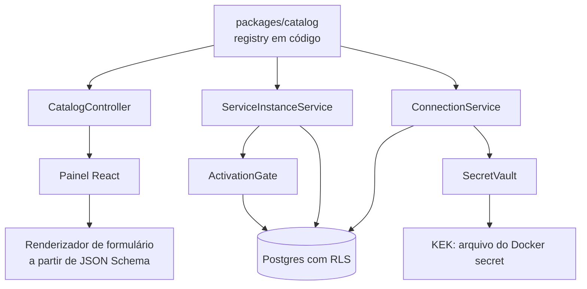

# M1 — Núcleo plugável: Design

**Spec:** `.specs/features/pluggable-core/spec.md`
**Status:** Draft
**Data:** 2026-09-06

---

## Visão geral

O M1 acrescenta três conceitos e a cola entre eles: um **catálogo** que vive no código, uma **instância** que o tenant instala e configura, e uma **conexão** que guarda credencial cifrada. O `ConnectorBinding` é a cola — liga a capability que o agente exige à conexão que a satisfaz.

A espinha dorsal do milestone é o gate de ativação. Ele é o ponto onde as três peças se encontram e onde uma configuração incompleta é recusada:

```
catálogo (código) ──► define capabilities exigidas
                              │
instância (tenant) ──► config validada contra o schema da versão fixada
                              │
conexão (tenant)  ──► credencial cifrada, estado active
                              │
                              ▼
                        gate de ativação
                              │
                     active  ou  recusa nomeando o que falta
```

Toda tabela nova é de tenant e herda a cadeia do M0 sem exceção: `withTenant` → `SET LOCAL app.tenant_id` → policy de RLS. O teste de introspecção do M0 cobre as três automaticamente.



---

## Componentes

### Registry do catálogo (`packages/catalog`)

- **Propósito:** ser a única fonte de verdade sobre o que existe para plugar.
- **Interface:**
  - `defineAgent(def): AgentDefinition` e `defineConnector(def): ConnectorDefinition` — construtores que validam o formato na própria chamada.
  - `catalog.agents` / `catalog.connectors` — mapas imutáveis indexados por `key@version`.
  - `getAgent(key, version)` / `getConnector(key)` — retornam `undefined` em vez de lançar; quem chama decide o que fazer com a ausência (é o caso da instância fixada numa versão que sumiu).
  - `validateCatalog(): CatalogIssue[]` — chamada no boot; lista chave duplicada, versão fora de semver, capability órfã e esquema fora do subconjunto suportado.
- **Dependências:** Zod e `zod-to-json-schema`. Não conhece NestJS nem banco — a regra de dependência do M0 se aplica (`catalog → core`).
- **Requisitos:** CAT-01 a CAT-05.

Uma definição de agente declara:

```ts
defineAgent({
  key: 'accounting-routine',
  version: '1.0.0',
  title: 'Rotina contábil',
  description: '...',
  configSchema: z.object({ ... }),
  capabilities: [
    { capability: 'file-storage',      required: true  },
    { capability: 'email',             required: true  },
    { capability: 'document-delivery', required: false },
    { capability: 'messaging',         required: false },
  ],
  dataCollections: [{ key: 'customers', schema: z.object({ ... }) }],
})
```

E uma de conector:

```ts
defineConnector({
  key: 'fortes-conecta',
  title: 'Fortes Conecta',
  capability: 'document-delivery',
  kind: 'native',
  authKind: 'api_key',
  authSchema: z.object({
    baseUrl: z.string().url(),
    apiKey:  secret(z.string().min(1)),
  }),
})
```

`secret()` é um marcador que anota o campo no schema (via `.describe()` estruturado, sem alterar o tipo). É ele que separa o que vai cifrado do que o painel pode exibir — sem essa marcação explícita, a decisão ficaria implícita no nome do campo, que é exatamente onde erros desse tipo nascem.

**Catálogo do M1** — definições reais, sem execução: o agente `accounting-routine` (config, capabilities e coleções, sem grafo) e os conectores `platform-upload`, `onedrive`, `google-drive`, `gmail`, `whatsapp` e `fortes-conecta` (capability, kind e `auth_schema`, sem adapter).

### Cofre de segredos (`packages/core/vault`)

Componente central do milestone; implementa o ADR-001.

- **Propósito:** cifrar e decifrar segredo de conector, sem que texto claro toque o banco nem o log.
- **Interface:**
  - `seal(tenantId, plaintext): Promise<SealedSecret>` — devolve `{ secretEnvelope, dekEnvelope, keyVersion, last4 }`.
  - `open(tenantId, sealed): Promise<string>` — só usada pelo M3 em diante; no M1 existe para o teste de ida e volta.
  - `rewrapDek(tenantId, sealed, toVersion): Promise<SealedSecret>` — recifra a DEK sob outra versão de KEK, sem tocar o segredo.
- **Camadas de chave:**

```
KEK        arquivo montado (Docker secret), uma por versão
  │  HKDF-SHA256(kek, salt=tenant_id, info='orquestra:tenant-kek:v<N>')
  ▼
chave do tenant   só em memória, nunca persistida
  │  AES-256-GCM
  ▼
DEK        32 bytes de CSPRNG por conexão, persistida cifrada
  │  AES-256-GCM
  ▼
segredo    persistido cifrado
```

- **Formato do envelope** (mesmo para segredo e para DEK), um `bytea` só em vez de colunas soltas — impossível gravar metade:

```
byte 0        versão do formato (0x01)
bytes 1..12   IV (96 bits, aleatório por operação)
bytes 13..28  tag de autenticação GCM (128 bits)
bytes 29..    ciphertext
```

- **Dado associado (AAD):** `tenant_id ‖ connection_id ‖ key_version` entra como AAD do GCM. Mover uma linha cifrada de um tenant para outro no banco não a torna decifrável — a autenticação falha.
- **Notas:** só `node:crypto`, sem dependência nova. A KEK é lida do caminho em `KEK_FILE` na subida; ausência derruba o processo (edge case declarado). O módulo nunca inclui plaintext em mensagem de erro, e um teste garante isso.
- **Requisitos:** SEC-01, SEC-02, SEC-06, SEC-07, ROT-04, ROT-05.

### Serviço de conexões (`apps/api/src/connections`)

- **Propósito:** ser o único caminho pelo qual credencial entra no sistema.
- **Interface:** `create`, `replaceSecret`, `revoke`, `list`, `check`.
- **Comportamento:**
  - Separa o payload em campos marcados como secretos e o resto: os primeiros vão ao cofre, os demais para `metadata` em claro.
  - `list` devolve um DTO que **não tem** campo de segredo — não é omissão em tempo de execução, é ausência no tipo. Um teste de contrato falha se o DTO ganhar um campo que venha do cofre.
  - `revoke` marca a conexão e, na mesma transação, pausa as instâncias que ficaram sem capability obrigatória.
  - `check` no M1 grava `unverified` e a data; a chamada real ao fornecedor entra no M3 atrás da mesma interface.
- **Requisitos:** SEC-03 a SEC-05, ROT-01 a ROT-03, CHK-01 a CHK-03.

### Serviço de instâncias e gate de ativação (`apps/api/src/service-instances`)

- **Propósito:** ciclo de vida da `ServiceInstance` e a decisão de ativar.
- **Interface:** `install`, `update`, `remove`, `bind`, `unbind`, `activate`, `pause`.
- **Gate (`ActivationGate.evaluate(instance): GateResult`)** — função pura sobre instância, bindings e catálogo, sem I/O. Retorna `{ ok: true }` ou a lista de impedimentos, cada um com código e mensagem:

```
  definição da versão fixada existe?         → AGENT_VERSION_MISSING
  config válida contra o schema da versão?   → CONFIG_INVALID (com os campos)
  toda capability obrigatória tem binding?   → CAPABILITY_UNBOUND (com as faltantes)
  toda conexão vinculada está active?        → CONNECTION_REVOKED
```

  Ser função pura é o que torna o gate testável sem banco e reutilizável pelo worker do M2, que precisa reavaliá-lo antes de executar.
- **Requisitos:** INST-01 a INST-06, BIND-01 a BIND-06.

### Renderizador de formulário (`apps/web/src/schema-form`)

- **Propósito:** montar o formulário de configuração a partir do JSON Schema do agente, sem tela por agente.
- **Subconjunto suportado** (validado no boot pelo `validateCatalog`, para que schema não suportado nunca chegue ao painel):

| Construto | Vira |
| --- | --- |
| `string` | campo de texto |
| `string` com `enum` | seleção |
| `string` com formato `email`/`uri` | texto com validação |
| `number` / `integer` | campo numérico |
| `boolean` | interruptor |
| `array` de `string` | lista editável |
| `object` de um nível | agrupamento |

- **Notas:** o `secret()` também é honrado aqui — campo secreto renderiza como senha e nunca recebe valor vindo do servidor, só o `last4` como texto de apoio.
- **Requisitos:** INST-03, CAT-03.

---

## Modelo de dados

Três tabelas, todas de tenant, todas com RLS obrigatória pela convenção do M0.

```sql
service_instances (
  id pk, tenant_id, agent_key, agent_version, name,
  config jsonb not null default '{}',
  status text not null,              -- installed | active | paused | removed
  status_reason text,                -- por que foi pausada (ex.: conexão revogada)
  created_at, updated_at, removed_at,
  unique (tenant_id, name) where removed_at is null
)

connector_connections (
  id pk, tenant_id, connector_key, name,
  metadata jsonb not null default '{}',   -- campos não secretos, em claro
  secret_envelope bytea not null,
  dek_envelope bytea not null,
  key_version int not null,
  last4 text not null,
  status text not null,                   -- active | revoked
  last_check_status text,                 -- unverified | ok | failed
  last_check_at timestamptz,
  created_at, updated_at, revoked_at,
  unique (tenant_id, connector_key, name)
)

connector_bindings (
  id pk, tenant_id,
  service_instance_id fk,
  capability text not null,
  connection_id fk,
  created_at,
  unique (service_instance_id, capability)
)
```

**Sem tabela de catálogo.** `agent_key`, `agent_version`, `connector_key` e `capability` são texto validado contra o registry na aplicação. A ausência de FK é deliberada: o catálogo é código, e código não tem linha em tabela. O preço — uma instância apontando para versão que sumiu — é pago pelo gate, que a recusa nomeando a versão ausente em vez de quebrar a listagem.

**Índices:** `(tenant_id, status)` em `service_instances`, `(tenant_id, connector_key)` em `connector_connections`, e `(connection_id)` em `connector_bindings` — este último serve à revogação, que precisa achar rapidamente as instâncias afetadas.

**Policy de RLS:** o mesmo padrão do M0, replicado nas três tabelas, com `enable` + `force` + policy `using`/`with check` sobre `nullif(current_setting('app.tenant_id', true), '')::uuid`. A forma com `nullif` é a corrigida no M0 (lição do T5).

**Por que segredo e DEK como `bytea` e não `text`:** evita conversão de codificação silenciosa, e torna óbvio, para quem lê o esquema, que aquilo não é para ser lido.

---

## Fluxos

### Cadastro de credencial (SEC-01, SEC-02)

```
painel                 API                        cofre                banco
  │  POST /connections   │                          │                    │
  │─────────────────────►│ separa secretos          │                    │
  │                      │ dos metadados            │                    │
  │                      │─────────────────────────►│ gera DEK           │
  │                      │                          │ cifra segredo      │
  │                      │                          │ cifra a DEK        │
  │                      │◄─────────────────────────│                    │
  │                      │ descarta o plaintext     │                    │
  │                      │─────────────────────────────────────────────► │ INSERT
  │◄─────────────────────│ 201 { id, last4, ... }   │                    │  (1 transação)
```

O plaintext existe apenas no escopo da requisição e nunca é atribuído a nada que sobreviva a ela — nem log, nem exceção, nem campo de DTO.

### Revogação (ROT-01, ROT-02)

```
revoke(connection)
   │
   ├─► connection.status = revoked            ─┐
   │                                            │  mesma transação:
   ├─► acha bindings que apontam pra ela        │  ou tudo, ou nada
   │                                            │
   └─► para cada instância ativa afetada:      ─┘
         perdeu capability obrigatória?
              sim → status = paused, status_reason = 'conexão revogada'
              não → segue ativa (era capability opcional)
```

### Rotação de KEK (ROT-04)

Comando de operador `orquestra kek:rotate --to-version N`, no mesmo padrão da CLI do M0:

```
para cada conexão com key_version < N:
    abre a DEK com a KEK antiga
    recifra a DEK com a KEK nova
    grava dek_envelope e key_version
    (o secret_envelope não é tocado)
```

Idempotente e retomável: interromper no meio deixa parte das conexões em `N` e parte em `N-1`, e ambas continuam legíveis, porque `key_version` diz por linha qual KEK usar. Rodar de novo termina o serviço.

---

## Superfície de API

```
GET    /catalog/agents                                     CAT-01
GET    /catalog/connectors                                 CAT-02

POST   /service-instances                                  INST-01
GET    /service-instances                                  INST-06
GET    /service-instances/:id
PATCH  /service-instances/:id                              INST-02, INST-04
DELETE /service-instances/:id                              INST-05
POST   /service-instances/:id/activate                     BIND-03 a BIND-05
POST   /service-instances/:id/pause                        BIND-06
PUT    /service-instances/:id/bindings/:capability         BIND-01, BIND-02
DELETE /service-instances/:id/bindings/:capability

POST   /connections                                        SEC-01
GET    /connections                                        SEC-03
PATCH  /connections/:id                                    SEC-04, ROT-03
POST   /connections/:id/revoke                             ROT-01, ROT-02
POST   /connections/:id/check                              CHK-01, CHK-02
```

Nenhuma rota devolve segredo. Não é uma regra de revisão: os DTOs de resposta são tipos que não possuem o campo, e um teste percorre todas as respostas procurando o valor semeado.

**Papéis:** `owner` e `admin` escrevem; `operator` só lê. O `operator` ganha poder de decisão no M2, com as aprovações.

---

## Painel

Três telas, penduradas no shell do M0.

| Tela | Conteúdo |
| --- | --- |
| Catálogo | Cards de agentes com capabilities exigidas; ação de instalar |
| Instância | Abas de Configuração (formulário gerado) e Conexões (capabilities e seus vínculos); ativar e pausar; impedimentos do gate exibidos como lista nomeada |
| Conexões | Conexões do tenant com fornecedor, `last4`, estado e última verificação; criar, substituir credencial e revogar |

O gate recusando ativação não é um erro genérico na tela: os códigos de impedimento viram uma lista do que falta, cada item ligado à aba onde se resolve.

---

## Tratamento de erros

| Cenário | Tratamento | O que o usuário vê |
| --- | --- | --- |
| KEK ausente ou ilegível na subida | Processo encerra na inicialização | Container não sobe; causa no log |
| Catálogo inválido (chave duplicada, capability órfã) | Processo encerra listando todos os problemas | Container não sobe; lista no log |
| Config inválida no salvamento | 422 com os campos e seus motivos | Erros ao lado de cada campo do formulário |
| Ativação com capability obrigatória sem vínculo | 409 com códigos de impedimento | Lista do que falta, com link para a aba |
| Instância fixada em versão ausente do catálogo | Listagem normal; ativação recusada | "Este serviço usa uma versão que não está mais disponível" |
| Conexão de outro tenant referenciada no vínculo | 404, idêntico a inexistente | "Conexão não encontrada" |
| Nome de conexão duplicado no mesmo conector | 409 antes de qualquer cifragem | "Já existe uma conexão com esse nome" |
| Falha de cifragem ou decifragem | Erro sanitizado; nunca inclui plaintext, chave ou envelope | Erro genérico de servidor; detalhe sem valor no log |
| Revogação de conexão em uso | Sempre aceita | "Conexão revogada. 2 serviços foram pausados." |

Regra herdada do M0 e reforçada aqui: nenhuma mensagem carrega segredo, chave, envelope ou string de conexão.

---

## Estratégia de teste

Cinco testes carregam o milestone.

**1. Contenção de segredo (o gate do M1).** Semeia uma credencial com valor sentinela improvável, exercita o fluxo inteiro — cadastro, listagem, vínculo, ativação, revogação — e então varre, procurando o sentinela: todas as respostas HTTP capturadas, todo o log emitido no período, e todas as colunas de texto e jsonb de todas as tabelas. Qualquer ocorrência reprova. (SEC-01, SEC-03, SEC-06)

**2. Isolamento.** As três tabelas novas entram automaticamente no teste de introspecção do M0 (RLS-01/RLS-06) — se alguma nascer sem policy, o build cai sem ninguém precisar lembrar. Some-se um teste de leitura cruzada de conexões entre dois tenants. (SEC-07)

**3. Criptografia.** Ida e volta com `open(seal(x)) === x`; o mesmo plaintext em dois tenants produz envelopes diferentes; envelope de um tenant não abre sob outro (o AAD falha); e rotação v1→v2 mantém legíveis tanto as conexões rotacionadas quanto as ainda em v1. (SEC-02, SEC-07, ROT-04, ROT-05)

**4. Gate de ativação.** Teste unitário puro, sem banco, cobrindo a matriz: obrigatória faltando, opcional faltando, config inválida, conexão revogada, versão ausente, e o caminho feliz. Mais um teste de integração da revogação que pausa a instância dependente. (BIND-03 a BIND-05, ROT-02)

**5. Integridade do catálogo.** `validateCatalog` reprova chave duplicada, versão fora de semver, capability órfã e schema fora do subconjunto do formulário — cada caso com sua própria asserção. (CAT-03, CAT-04)

Segue a divisão do M0 (`.specs/codebase/TESTING.md`): unitários para cofre, gate e validação de catálogo; integração com Postgres real (Testcontainers) para RLS, revogação e rotação; e2e para o fluxo do painel com a API real.

---

## Decisões técnicas

| Decisão | Escolha | Razão |
| --- | --- | --- |
| Onde vive o catálogo | Registry em código, sem tabela | Uma fonte de verdade. Sincronizar código para tabela criaria divergência a cada mudança de versão, em troca de uma FK que a validação de boot já substitui |
| Fonte do schema de configuração | Zod, com JSON Schema derivado | O projeto já padronizou Zod em `contracts`; o tipo TypeScript sai de graça e o formulário também. JSON Schema como fonte obrigaria manter tipos à mão |
| Forma da DEK | Aleatória por conexão, guardada cifrada | Rotacionar a KEK recifra só as DEKs. Derivar a DEK por HKDF dispensaria persistir, mas obrigaria recifrar todo segredo a cada rotação — o oposto da rotação incremental do ADR-001 |
| Derivação da chave de tenant | HKDF-SHA256 sobre a KEK, com `tenant_id` como sal | Isolamento entre tenants sem uma chave por tenant para custodiar. Comprometer a chave derivada de um não alcança os demais |
| Algoritmo | AES-256-GCM com AAD `tenant ‖ conexão ‖ versão` | Cifra e autentica de uma vez; o AAD amarra o ciphertext ao seu lugar, então mover linha entre tenants não decifra |
| Formato de armazenamento | Envelope binário único (`versão‖IV‖tag‖ciphertext`) | Colunas separadas permitem gravar metade e criar linha irrecuperável; um `bytea` só é atômico por construção |
| Marcação de campo secreto | `secret()` explícito no schema | Deduzir pelo nome do campo é onde esse tipo de erro nasce. Explícito é verificável por teste |
| OAuth | Adiado para o M3 | Sem adapter que consuma o token não há como provar o fluxo. As colunas necessárias já existem |
| Gate de ativação | Função pura sobre catálogo, instância e bindings | Testável sem banco e reutilizável pelo worker do M2, que reavalia antes de executar |
| Formulário por schema | Renderizador próprio sobre subconjunto documentado | O subconjunto é validado no boot, então schema não suportado nunca chega à tela. Biblioteca genérica traria peso e aparência desproporcionais |
| Revogação | Sempre aceita; pausa as instâncias afetadas | Contenção de incidente não pode virar negociação de dependência |

---

## Riscos residuais

| Risco | Mitigação |
| --- | --- |
| Perda da KEK torna todo segredo irrecuperável | Procedimento de custódia no README do operador, e `kek:rotate` provado em teste antes de existir credencial real |
| Um DTO futuro passar a expor segredo por descuido | O teste de contenção varre respostas por valor sentinela, não por nome de campo — cobre inclusive campo novo com nome inocente |
| Instância presa a versão de agente removida do código | Gate recusa nomeando a versão; a instância continua legível e reconfigurável |
| Subconjunto do formulário apertado demais para um agente futuro | `validateCatalog` reprova na subida, em desenvolvimento, muito antes de produção — a pressão aparece cedo e barata |
| O M2 reintroduzir segredo no payload de job | O job carrega ponteiros, e o teste de contenção passa a varrer também a fila quando ela existir |

---

## Rastreabilidade

| Requisitos | Onde são atendidos |
| --- | --- |
| CAT-01 a CAT-05 | `packages/catalog` + `CatalogController` |
| INST-01 a INST-06 | `ServiceInstanceService` + tabela `service_instances` |
| SEC-01, SEC-02, SEC-06, SEC-07 | Cofre (`packages/core/vault`) |
| SEC-03 a SEC-05 | `ConnectionService` + DTOs sem campo de segredo |
| BIND-01 a BIND-06 | `ConnectorBinding` + `ActivationGate` |
| ROT-01 a ROT-03 | `ConnectionService.revoke` / `replaceSecret` |
| ROT-04, ROT-05 | `rewrapDek` + comando `kek:rotate` + coluna `key_version` |
| CHK-01 a CHK-03 | `ConnectionService.check` + colunas de última verificação |
| INST-03 (painel) | Renderizador de formulário em `apps/web/src/schema-form` |
