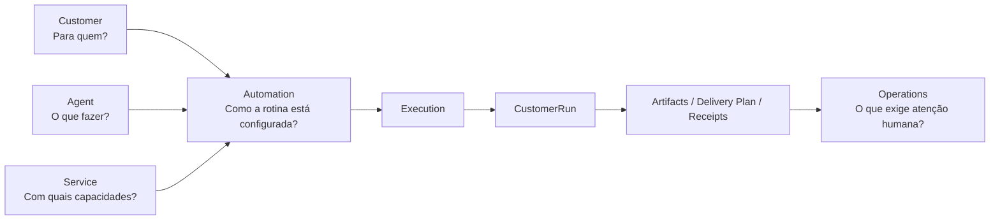
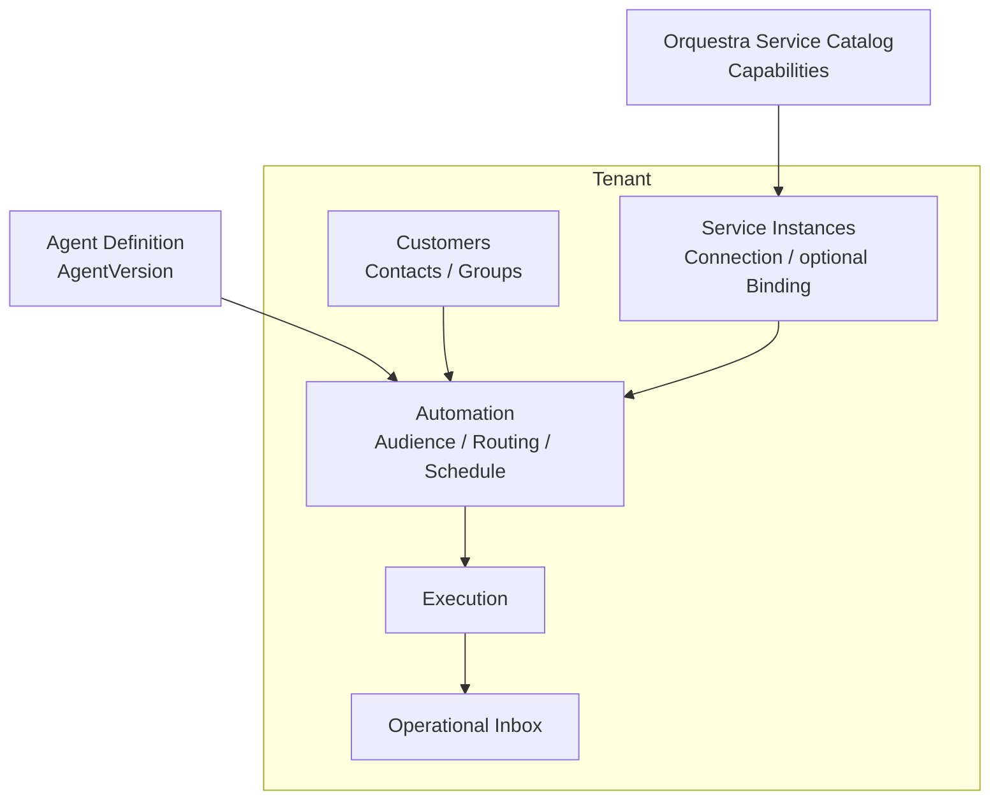
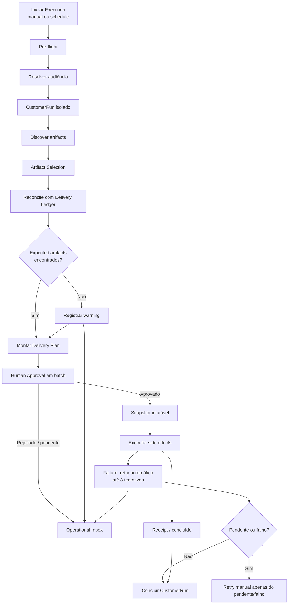

# PRD — Orquestra MVP

## Controle do documento

| Campo | Valor |
|---|---|
| Versão | 1.0 |
| Estado | Pronto para especificação técnica |
| Decisão de produto | A discovery dos domínios centrais está consolidada neste documento. |
| Fonte | Conversa de discovery “Arquitetura da Orquestra”. |
| Próxima etapa | Modelo de domínio e Implementation Spec; os desenhos de UX listados na seção 26 podem ocorrer em paralelo. |

### Histórico de versão

| Versão | Data | Alteração |
|---|---|---|
| 1.0 | 2026-10-03 | Consolidação do MVP, regras de domínio, operações e UC-001. |

## 1. Resumo executivo

Orquestra é uma plataforma multitenant para escritórios configurarem e executarem rotinas operacionais recorrentes para sua carteira de clientes. Ela combina **Agents** (o trabalho a realizar), **Services** (as capacidades disponíveis), **Customers** (para quem a rotina ocorre) e **Automations** (a configuração da rotina) para produzir execuções auditáveis.

O MVP começa pelo fluxo de distribuição mensal de documentos: descobrir arquivos em um sistema de origem, selecionar os relevantes, alertar quando um documento esperado estiver ausente, submeter um plano de entrega à aprovação humana e realizar envios por canais configurados. A plataforma não deve repetir automaticamente um side effect já concluído, mesmo após falhas parciais e retries.

O resultado esperado não é apenas “automatizar envio”: é permitir que o escritório responda, com evidência, **o que foi encontrado, o que foi aprovado, o que foi entregue, o que falhou e o que ainda exige atenção humana**.

## 2. Contexto e problema

Escritórios executam processos recorrentes que atravessam clientes, sistemas de terceiros, documentos e canais de comunicação. A execução manual exige buscar arquivos, identificar os relevantes, conferir faltas, agrupá-los, enviar por mais de um canal e registrar o resultado. Esse fluxo consome tempo, torna difícil manter consistência e enfraquece a rastreabilidade quando há falha ou dúvida posterior.

Os problemas centrais são:

- a carteira de clientes, os sistemas integrados e a rotina operacional são conceitos diferentes, mas hoje tendem a se misturar em controles manuais;
- uma falha para um cliente pode ocultar o progresso dos demais;
- operações com side effect — por exemplo, enviar um documento — não podem ocorrer sem controle humano e sem histórico verificável;
- retry sem idempotência pode reenviar uma mensagem ou documento que já foi entregue;
- itens que exigem ação, como um documento esperado ausente ou uma entrega falha, não podem desaparecer apenas porque a execução terminou.

## 3. Visão do produto

Orquestra organiza operações recorrentes em uma camada de produto explícita: um escritório mantém sua carteira, instala Services fornecidos pela plataforma, escolhe um Agent, configura uma Automation e acompanha cada execução por cliente. Pessoas entram por convite e operam somente nos tenants aos quais possuem Membership ativa.

## 4. Objetivos e não objetivos

### Objetivos

- Configurar uma rotina recorrente para uma audiência de Customers.
- Descobrir e selecionar artifacts relevantes por regras simples de nome/extensão.
- Garantir aprovação humana antes de qualquer side effect.
- Isolar o progresso de cada Customer em um `CustomerRun`.
- Entregar por canais configurados, registrar receipts e tratar falhas parciais.
- Dar visibilidade operacional persistente para aprovações, warnings, failures e problemas de configuração.
- Manter uma trilha auditável e tecnicamente observável de cada decisão e tentativa.

### Não objetivos

- Substituir sistemas de origem, CRM ou ferramentas de comunicação.
- Criar um rule engine genérico ou um marketplace de integrações.
- Automatizar side effects sem Human Gate.
- Definir uma arquitetura, banco de dados ou stack neste documento.

## 5. Princípios e invariantes do produto

1. **Customer não é Service.** A carteira e a integração têm ciclos de vida independentes.
2. **Agent não é Automation.** Agent descreve o trabalho e suas necessidades; Automation configura uma instância dessa rotina para um tenant.
3. **Agent não conhece provider.** A escolha de provider pertence à Automation, com override possível por Customer.
4. **Service é capability, não apenas conexão.** Uma Automation depende de capacidades tipadas e compatíveis, não de nomes de integrações soltos.
5. **Todo side effect exige Human Gate.** Nenhuma entrega é disparada sem aprovação prévia do `Delivery Plan`.
6. **Uma Execution contém CustomerRuns isolados.** Problema em um Customer não deve interromper ou mascarar o resultado dos outros.
7. **Warnings não são status de execução.** Um run pode concluir com warning; warning permanece operacionalmente visível até tratamento humano.
8. **Idempotência protege a entrega.** Side effect concluído não é repetido automaticamente.
9. **Reenvio é explícito e auditado.** Quando o usuário optar por reenviar algo já concluído, a ação deve ser consciente, registrada e distinguível de retry.
10. **Operations projeta atenção; não duplica o domínio.** A Inbox representa itens acionáveis originados nos demais domínios.
11. **Configuração deve provar readiness antes da ativação.** Falta de capability, connection ou requisito de Agent impede uma Automation de estar pronta.

## 6. Atores e permissões

| Ator | Responsabilidades no MVP |
|---|---|
| Administrador do tenant | Gerencia Customer, contatos e grupos; instala/configura Service; cria e mantém Automation; opera e consulta dados do tenant. |
| Operador autorizado do tenant | Consulta carteira e execuções, trata a Operational Inbox, aprova/rejeita planos e realiza retries manuais permitidos. |
| Usuário multi-tenant | Pessoa com Membership ativa em mais de um tenant; alterna de contexto e atua conforme o papel concedido em cada escritório. |
| Scheduler | Inicia execução agendada; não aprova nem realiza decisões humanas. |
| Plataforma Orquestra | Mantém o catálogo de Services e Agents disponíveis; executa processamento e registra evidências. |

### Regras de permissão

- Somente **Administradores** podem instalar ou configurar um `Service` no tenant, incluindo sua credencial, Connection e Binding quando aplicável.
- O catálogo de Services é criado e mantido somente pela **Orquestra**, não pelos tenants.
- Somente usuários autorizados do tenant podem visualizar ou atuar sobre dados daquele tenant.
- Aprovação humana, resolução/ignoramento de itens e retry manual devem registrar quem realizou a ação e quando.
- O MVP adota RBAC. `Administrator` e `Operator` são os papéis iniciais; a matriz detalhada de permissões por ação deve ser fechada antes da implementação de autorização.
- Um usuário pode acessar mais de um tenant somente quando possuir convite aceito e Membership ativa para cada tenant.
- Usuário removido, convite expirado e tenant desativado não concedem acesso.

## 7. Glossário

| Termo | Definição |
|---|---|
| Tenant | Escritório isolado dentro da Orquestra. |
| User Account | Identidade da pessoa na Orquestra, independente de sua participação em tenants. |
| Membership | Associação ativa entre um User Account e um tenant, com papel RBAC concedido naquele contexto. |
| Invitation | Convite por email para ingressar em um tenant; só passa a conceder acesso depois de aceito e enquanto válido. |
| RBAC | Controle de acesso baseado em papel, aplicado por Membership e por tenant. |
| Customer | Empresa atendida pelo tenant. |
| Agent | Definição/versionamento do trabalho a executar, independente de provider. |
| Service | Integração do catálogo Orquestra que expõe capabilities. |
| Service Instance | Instalação de um Service em um tenant. No MVP há uma por Service/Tenant. |
| Connection | Conexão autenticada/configurada do tenant com um Service. |
| Binding | Vínculo opcional necessário para usar uma capability em um contexto específico. |
| Capability | Operação tipada disponibilizada por um Service; pode ou não ter side effect. |
| Automation | Configuração de uma rotina: AgentVersion, audiência, agendamento, seleção de providers, regras e destinos. |
| Enrollment | Participação de um Customer em uma Automation, com estado e overrides próprios. |
| Execution | Uma rodada da Automation, manual ou agendada. |
| CustomerRun | Parcela isolada da Execution para um Customer. |
| Artifact | Arquivo/objeto descoberto e processado durante um CustomerRun. |
| Delivery Package | Agrupamento de artifacts para uma entrega coerente a um destinatário/canal. |
| Delivery Plan | Conjunto revisável de packages, canais e side effects propostos para um escopo de execução. |
| Human Gate | Aprovação humana requerida antes de realizar side effects. |
| Delivery Attempt | Registro de uma tentativa de side effect. |
| Receipt | Evidência retornada de uma entrega concluída. |
| Delivery Ledger | Registro de reconciliação que impede repetição automática de side effect já concluído. |
| Warning | Condição relevante que não impede a conclusão; exige visibilidade e tratamento operacional. |

## 8. Visão conceitual dos domínios

| Domínio | Pergunta que responde | Responsabilidade |
|---|---|---|
| Customer | Para quem? | Carteira, identificação, contatos, grupos e elegibilidade. |
| Agent | O que fazer? | Trabalho versionado, requisitos de capability e Human Gate. |
| Service | Com quais capacidades? | Catálogo, instalação, conexão, capability e saúde da integração. |
| Automation | Como a rotina está configurada? | Composição de Agent, audiência, agenda, regras, roteamento e overrides. |
| Execution | O que aconteceu nesta rodada? | Processamento isolado, artifacts, aprovação, entrega, retry e receipts. |
| Operations | O que requer atenção? | Projeção compartilhada de aprovações, warnings, failures e configuration issues. |

## 9. Requisitos funcionais

### 9.0 Identity & Access

| ID | Requisito |
|---|---|
| IAM-001 | O produto deve permitir criação de tenant por autoatendimento e provisionamento pela equipe Orquestra. |
| IAM-002 | O primeiro Administrator de um tenant deve ingressar por convite. |
| IAM-003 | Novos Administrators e Operators devem ingressar no tenant por convite enviado por email. |
| IAM-004 | Após aceitar convite válido, o usuário deve obter Membership ativa no tenant com o papel RBAC concedido. |
| IAM-005 | Um User Account pode possuir Membership ativa em múltiplos tenants e deve conseguir alternar explicitamente o contexto ativo. |
| IAM-006 | Toda autorização deve ser avaliada no tenant ativo e segundo o papel RBAC da Membership correspondente. |
| IAM-007 | Usuário removido, convite expirado e tenant desativado não devem permitir acesso ao tenant. |
| IAM-008 | A criação, aceite, expiração, remoção e mudança de papel de Membership devem ser auditáveis. |

### 9.1 Customer Domain

| ID | Requisito |
|---|---|
| CUS-001 | O administrador deve cadastrar Customer manualmente usando CNPJ como identificador empresarial no MVP. |
| CUS-002 | O sistema deve manter o estado `ACTIVE` ou `INACTIVE` para cada Customer. Apenas Customers `ACTIVE` participam da audiência `ALL_ACTIVE`. |
| CUS-003 | O administrador deve cadastrar e manter múltiplos contatos por Customer. |
| CUS-004 | O administrador deve organizar Customers em grupos para uso na gestão da carteira e seleção de audiência quando aplicável. |
| CUS-005 | O sistema deve manter a modelagem preparada para CPF e custom fields futuros, sem disponibilizá-los como funcionalidade do MVP. |
| CUS-006 | Um Customer `INACTIVE` não deve iniciar novos CustomerRuns por `ALL_ACTIVE`; o tratamento de runs já existentes é definido pelo ciclo da execução. |

### 9.2 Agent Domain

| ID | Requisito |
|---|---|
| AGT-001 | A plataforma deve manter Agents independentes de providers e Services concretos. |
| AGT-002 | Todo uso de Agent em Automation deve referenciar uma `AgentVersion` explícita. |
| AGT-003 | Um Agent deve declarar capability slots/requirements tipados necessários para executar seu trabalho. |
| AGT-004 | O sistema deve avaliar se os requirements do Agent são atendidos pelos Services selecionados antes de considerar a Automation pronta. |
| AGT-005 | O Agent deve declarar quando o fluxo contém side effects que exigem Human Gate. |

### 9.3 Service Domain

| ID | Requisito |
|---|---|
| SRV-001 | O catálogo de Services deve ser criado e administrado exclusivamente pela Orquestra. |
| SRV-002 | Somente Administradores podem instalar/configurar um Service para o tenant. |
| SRV-003 | O MVP deve suportar uma única Service Instance por combinação `Service/Tenant`. |
| SRV-004 | A credencial de um Service deve pertencer ao escritório/tenant, não ao Customer. |
| SRV-005 | Uma instalação deve expor uma Connection para uso das capabilities; Binding é opcional e só se aplica quando requerido pelo contexto da capability. |
| SRV-006 | Cada capability deve ser tipada e declarar se produz `sideEffect`. |
| SRV-007 | O sistema deve oferecer health/pre-flight para validar se a instalação/conexão está utilizável antes da execução. |
| SRV-008 | A Automation deve selecionar o provider/Service adequado por capability; o Customer pode receber override dessa escolha. |
| SRV-009 | Problema de connection, binding ou capability requerida deve aparecer como configuration issue na Operations quando exigir ação humana. |

### 9.4 Automation Domain

| ID | Requisito |
|---|---|
| AUT-001 | O administrador deve criar uma Automation a partir de uma `AgentVersion`. |
| AUT-002 | A Automation deve suportar audiência `ALL_ACTIVE` e `SELECTED`. |
| AUT-003 | Cada Customer inscrito deve possuir Enrollment `PENDING`, `READY`, `PAUSED` ou `BLOCKED`. |
| AUT-004 | Cada Automation deve possuir um único schedule no MVP. Execução manual também deve ser possível. |
| AUT-005 | A Automation deve permitir defaults e customer overrides para configurações que variam por Customer. |
| AUT-006 | A Automation deve definir routing para os destinos/canais de entrega e a seleção de provider por capability. |
| AUT-007 | Artifact Selection deve suportar `startsWith`, `contains`, `endsWith`, `equals` e filtro simples por extensão; regex não integra o MVP. |
| AUT-008 | Artifacts descobertos que não atendam à Artifact Selection devem ser ignorados para a entrega. |
| AUT-009 | Expected Artifacts devem gerar warning quando ausentes, mas não bloquear o CustomerRun nem a criação do Delivery Plan com os artifacts disponíveis. |
| AUT-010 | O sistema deve avaliar readiness antes da ativação, incluindo Agent requirements, Service health/configuração, audiência e dados necessários. |
| AUT-011 | A Automation deve ter lifecycle `DRAFT`, `ACTIVE`, `PAUSED` e `ARCHIVED`. |
| AUT-012 | Apenas Automation `ACTIVE` pode iniciar execução agendada; `PAUSED` interrompe novas execuções agendadas e `ARCHIVED` preserva histórico sem permitir operação. |

### 9.5 Execution Domain

| ID | Requisito |
|---|---|
| EXE-001 | Uma Execution deve representar uma rodada manual ou agendada de uma Automation. |
| EXE-002 | Uma Execution deve criar e acompanhar CustomerRuns isolados para os Customers elegíveis. |
| EXE-003 | Cada CustomerRun deve registrar descoberta de artifacts, filtragem, warnings, reconciliação e resultado de entrega de forma rastreável. |
| EXE-004 | A reconciliação deve consultar o Delivery Ledger para identificar artifacts/side effects já concluídos e impedir repetição automática. |
| EXE-005 | `COMPLETED` significa que o processamento planejado para o CustomerRun terminou; warnings podem coexistir com esse resultado. |
| EXE-006 | `NOTHING_TO_DO` significa que não há artifacts novos/relevantes que exijam side effect para o CustomerRun. Não é falha. |
| EXE-007 | Warnings devem permanecer separados do status de Execution e CustomerRun. |
| EXE-008 | O sistema deve montar Delivery Packages e um Delivery Plan com artifacts, destinatários, canais e side effects propostos. |
| EXE-009 | O sistema deve permitir Human Approval em batch para o Delivery Plan no escopo apresentado ao operador. |
| EXE-010 | Após aprovação, o sistema deve manter snapshot imutável do Delivery Plan aprovado. |
| EXE-011 | Nenhum side effect pode ser realizado antes da aprovação correspondente. |
| EXE-012 | Cada side effect deve produzir Delivery Attempts e, quando concluído, Receipt ou evidência equivalente. |
| EXE-013 | Falha de um side effect/canal deve permitir que outros side effects independentes prossigam; o resultado pode ser `PARTIAL_FAILURE`. |
| EXE-014 | O retry automático deve executar no máximo 3 tentativas por ciclo para side effects pendentes ou falhos. |
| EXE-015 | Retry manual deve atuar somente sobre side effects pendentes ou falhos, preservando os já concluídos. |
| EXE-016 | A aprovação deve continuar válida enquanto o Delivery Plan não mudar. Se o plano mudar, uma nova aprovação é obrigatória. |
| EXE-017 | O sistema não deve repetir automaticamente side effect concluído. |
| EXE-018 | Reenvio de side effect já concluído só pode ocorrer por ação explícita do usuário, com motivo/registro auditável; não é um retry. |

### 9.6 Operations Domain

| ID | Requisito |
|---|---|
| OPS-001 | O MVP deve oferecer uma Operational Inbox compartilhada entre usuários autorizados do tenant. |
| OPS-002 | A Inbox deve projetar itens de `Approvals`, `Warnings`, `Failures` e `Configuration issues`. |
| OPS-003 | Um warning deve permanecer visível até ser marcado como `resolved` ou `ignored`, sem apagar o histórico. |
| OPS-004 | Uma failure deve permanecer visível até retry bem-sucedido ou encerramento humano do problema. |
| OPS-005 | Configuration issues devem permanecer visíveis até correção da configuração ou encerramento explícito. |
| OPS-006 | A Inbox deve permitir acesso ao contexto da execução/CustomerRun que originou o item. |
| OPS-007 | O MVP não inclui notificações externas, assignment, SLA ou escalation, mas o domínio deve permitir evolução futura desses mecanismos. |

## 10. Regras de negócio transversais

| ID | Regra |
|---|---|
| BR-001 | Tenant isolation é obrigatório: dados, credenciais, execuções, artefatos e operações de um tenant não podem ficar disponíveis a outro tenant. |
| BR-001A | Acesso a um tenant exige Membership ativa; trocar de tenant não transfere permissões nem dados entre escritórios. |
| BR-002 | Um Customer só participa de uma Automation quando está na audiência e possui Enrollment apto; `PAUSED` e `BLOCKED` impedem novo processamento até mudança de estado. |
| BR-003 | Expected Artifact ausente cria warning, não bloqueio. |
| BR-004 | Uma falha por Customer não interrompe os CustomerRuns dos demais. |
| BR-005 | O Delivery Plan aprovado é uma evidência histórica imutável. Alterações de conteúdo, canal, destinatário ou side effect invalidam sua aprovação. |
| BR-006 | Retry é continuação de trabalho pendente/falho; reenvio é novo ato consciente sobre trabalho concluído. |
| BR-007 | Operations não altera os fatos de origem; ela expõe ações e estados para atenção humana. |

## 11. Fluxos críticos

### 11.0 Entrada, criação e acesso ao tenant

1. Um tenant pode nascer por autoatendimento ou ser provisionado pela equipe Orquestra.
2. O primeiro Administrator recebe um convite e entra ao aceitá-lo.
3. Esse Administrator convida novos usuários, atribuindo papel RBAC no tenant.
4. Um usuário com convites aceitos em mais de um escritório escolhe o tenant em que deseja atuar antes de acessar recursos operacionais.
5. Remoção da Membership, expiração do convite ou desativação do tenant encerra o acesso ao contexto correspondente.

### 11.1 Cadastro de Customer

1. Administrador cadastra uma empresa com CNPJ.
2. Inclui um ou mais contatos e, se necessário, associa grupos.
3. Define o Customer como `ACTIVE` ou `INACTIVE`.
4. Customers `ACTIVE` passam a poder compor `ALL_ACTIVE`; a elegibilidade final depende da Automation e do Enrollment.

### 11.2 Instalação e configuração de Service

1. Administrador seleciona um Service do catálogo Orquestra.
2. Configura a credencial pertencente ao tenant e estabelece a Connection.
3. Configura Binding se a capability aplicável o requerer.
4. Executa health/pre-flight.
5. Problemas de configuração ficam visíveis na Operational Inbox até tratamento.

### 11.3 Criação e ativação de Automation

1. Administrador seleciona uma `AgentVersion`.
2. Define audiência, schedule único e Enrollment dos Customers.
3. Configura defaults, customer overrides, routing e providers por capability.
4. Configura Artifact Selection e Expected Artifacts.
5. O sistema verifica readiness.
6. Com requisitos atendidos, administrador ativa a Automation; caso contrário, mantém `DRAFT` e apresenta o impedimento.

### 11.4 Execution → Approval → Retry

## 12. UC-001 — Distribuição mensal de documentos

### Objetivo

Distribuir mensalmente documentos de tributos de cada Customer, após revisão humana, usando email e WhatsApp como canais do caso de referência.

### Configuração de referência

| Elemento | Configuração |
|---|---|
| Audience | `ALL_ACTIVE` ou conjunto selecionado pelo administrador. |
| Source | Service compatível com descoberta de arquivos. |
| Artifact Selection | `startsWith(DAS_)`, `startsWith(DARF_)`, `startsWith(FGTS_)` e extensão simples `.pdf` quando aplicável. |
| Expected Artifacts | DAS, DARF, FGTS. |
| Routing | Um email por Customer, com os arquivos elegíveis agrupados como anexos; uma operação de WhatsApp por Customer conforme o plano. |
| Human Gate | Aprovação em batch que mostra todos os documentos e canais propostos. |

### Fluxo de exemplo

1. O Scheduler ou operador inicia a Automation mensal.
2. Para a Empresa ABC, o sistema encontra 50 arquivos no source.
3. Artifact Selection identifica `DAS_...`, `DARF_...` e `FGTS_...` como candidatos. Arquivos não correspondentes são ignorados.
4. O sistema encontra DAS e FGTS, mas não DARF.
5. Cria warning “DARF esperado não encontrado”. Isso não bloqueia a entrega de DAS e FGTS.
6. A reconciliação consulta o Delivery Ledger: itens já entregues não entram novamente como side effects automáticos.
7. O sistema monta um Delivery Package de email com DAS e FGTS como anexos e uma operação de WhatsApp para o mesmo Customer.
8. O Delivery Plan em batch mostra todos os Customers, documentos, warnings e canais. Um operador aprova.
9. O snapshot aprovado é preservado. Email e WhatsApp são executados como side effects independentes.
10. Se email concluir e WhatsApp falhar, o CustomerRun pode ficar em `PARTIAL_FAILURE`. O sistema tenta novamente o WhatsApp no máximo três vezes no ciclo, sem reenviar o email.
11. Após tentativas esgotadas, a failure permanece na Inbox até retry manual bem-sucedido ou encerramento. O warning de DARF permanece até `resolved` ou `ignored`.
12. Em retry manual, apenas a operação de WhatsApp pendente/falha é executada. Um reenvio do email já concluído exige ação explícita e auditada.

### Resultado esperado do UC-001

- `COMPLETED` quando o processamento e todos os side effects necessários terminarem, mesmo que exista warning de artifact esperado ausente.
- `NOTHING_TO_DO` quando não houver artifacts novos/relevantes para entregar.
- `PARTIAL_FAILURE` quando algum side effect falhar após o tratamento aplicável, sem apagar sucesso de outros canais.

## 13. Auditoria e observabilidade técnica

### Auditoria funcional

O sistema deve permitir reconstruir, por exemplo: início da Execution, artifacts encontrados/ignorados, warning emitido, Delivery Plan criado, identidade do aprovador, snapshot aprovado, cada Delivery Attempt, Receipt, retry e ação de resolve/ignore/encerramento.

Eventos auditáveis incluem, no mínimo:

- mudança de estado de Customer, Enrollment e Automation;
- instalação/configuração e health de Service;
- criação/início/fim de Execution e CustomerRun;
- criação, aprovação, rejeição ou invalidação de Delivery Plan;
- side effect, tentativa, receipt, retry e reenvio explícito;
- ações na Operational Inbox.

### Observabilidade técnica

Observabilidade operacional e técnica atendem públicos distintos. O operador vê uma falha acionável; suporte/admin técnico precisa de correlação entre Execution, CustomerRun, Service, Capability, Attempt, duração, erro e trace/correlation ID quando disponível. A forma exata de instrumentação é decisão de arquitetura.

## 14. Requisitos não funcionais

| Área | Requisito |
|---|---|
| Multitenancy | O produto deve garantir isolamento de tenant para dados, execução, artifacts, credenciais e ações operacionais. |
| Segurança de secrets | Credenciais e secrets de Services não devem ser expostos em telas, logs de negócio, artifacts ou trilhas de auditoria. |
| Controle de acesso | Autenticação, convite, Membership e RBAC devem impedir acesso de usuários sem associação ativa ao tenant. |
| Rastreabilidade | O sistema deve conservar a cadeia Automation → Execution → CustomerRun → Delivery Plan → Attempt → Receipt. |
| Idempotência | Reprocessamento e retry não podem repetir automaticamente side effects concluídos. |
| Resiliência | Falhas devem ser isoladas por CustomerRun e side effect sempre que o fluxo permitir. |
| Observabilidade | Deve ser possível diagnosticar falhas com contexto operacional e técnico suficiente. |
| Integridade da aprovação | Side effects só podem usar plano aprovado e imutável; mudança no plano requer nova aprovação. |
| Privacidade | O acesso a dados de Customers e contatos deve respeitar a autorização do tenant. |

Este PRD não define schema de banco, mecanismo de fila, provider de secrets, protocolo de retry ou tecnologia de observabilidade.

## 15. Escopo do MVP

### IN

- Criação de tenant por autoatendimento ou pela equipe Orquestra; entrada e inclusão de usuários por convite; Membership multi-tenant e RBAC inicial.
- Customer com CNPJ, estado, múltiplos contatos, grupos e cadastro manual.
- Catálogo de Services mantido pela Orquestra; instalação por administrador; uma instance por Service/Tenant; credencial por tenant; Connection, Binding opcional, capabilities e health/pre-flight.
- Agent versionado e independente de provider, com requirements/slots de capability e Human Gate.
- Automation com audiência, Enrollments, um schedule, defaults, overrides, routing, seleção de artifacts, expected artifacts, readiness e lifecycle.
- Execution manual/agendada, CustomerRuns isolados, discovery/filtering/reconcile, Delivery Plan, aprovação em batch, receipts e retries.
- Operational Inbox compartilhada para aprovações, warnings, failures e configuration issues.
- UC-001 como fatia de referência: documentos DAS/DARF/FGTS, email, WhatsApp, warning e retry idempotente.

### OUT

- CPF e custom fields builder.
- Importação, sincronização ou enriquecimento automático da carteira.
- Tenant criar seu próprio Service ou marketplace de Services.
- Múltiplas Service Instances do mesmo Service no tenant.
- Rule engine genérico e regex em Artifact Selection.
- Múltiplos schedules por Automation.
- Notificações externas por email, WhatsApp, push ou outros canais para itens da Inbox.
- Assignment, owner, SLA e escalation operacional.
- Aprovação automática ou execução de side effect sem Human Gate.

## 16. Métricas de sucesso

O MVP deve instrumentar métricas sem estabelecer metas antes de um baseline operacional. Metas serão definidas após coleta inicial.

| Métrica | Uso |
|---|---|
| Tempo de configuração de uma Automation | Mede esforço para tornar uma rotina operável. |
| Tempo de Execution até aprovação e entrega | Mede fluidez operacional. |
| Customers/CustomerRuns processados | Mede cobertura da operação. |
| Artifacts descobertos, selecionados e entregues | Mede volume e qualidade da seleção. |
| Taxa de Delivery Attempts concluídos | Mede confiabilidade percebida da entrega. |
| Taxa e causa de retries | Identifica fragilidade de Services/canais. |
| Warnings e failures abertos por período | Identifica carga operacional e lacunas de configuração. |
| Reenvios explícitos | Monitora exceções e risco operacional. |

## 17. Riscos, hipóteses e open questions

### Riscos

| Risco | Impacto | Mitigação de produto |
|---|---|---|
| Configuração incorreta de Service | Bloqueia ou compromete operações. | Readiness, health/pre-flight e configuration issues persistentes. |
| Aprovação em batch com escopo excessivo | Operador aprova sem revisão suficiente. | Mostrar documentos, canais e warnings de forma clara; detalhamento de UX na próxima etapa. |
| Ambiguidade de identidade de artifact | Pode produzir duplicidade ou omissão em reconciliação. | Validar a chave de deduplicação na especificação técnica. |
| Falhas de provider | Entrega parcial e carga na Inbox. | Retry limitado, Receipt, isolamento e retry manual focalizado. |
| Crescimento de exceções | Pode pressionar o MVP para virar rule engine. | Manter regras simples e explicitar itens fora de escopo. |

### Hipóteses a validar

- O Human Gate em batch mantém controle sem inviabilizar o ganho operacional.
- Os critérios simples de Artifact Selection cobrem o caso inicial sem regex.
- Uma única Service Instance por Service/Tenant atende a primeira etapa do produto.
- A Operational Inbox compartilhada é suficiente antes de assignment e SLA.

### Open Questions / TBD

| ID | Questão | Classificação |
|---|---|---|
| OQ-001 | Qual é a matriz de permissões RBAC por ação para `Administrator` e `Operator`, incluindo aprovação, retry, reenvio, resolve/ignore e gestão de Membership? | Bloqueante para implementação de autorização; não exige criar mais papéis no MVP. |
| OQ-002 | Como a identidade de um artifact e sua relação com o Delivery Ledger serão definidas para garantir deduplicação entre ciclos? | Bloqueante técnico para implementação de idempotência; pertence à Implementation Spec. |
| OQ-003 | Quais alterações específicas no Delivery Plan invalidam aprovação, além de conteúdo, destinatário, canal e side effect? | Bloqueante de regra detalhada antes da implementação da aprovação. |
| OQ-004 | Quais providers concretos compõem o UC-001 e quais capabilities exatas oferecem? | Bloqueante de escolha para o walking skeleton; não bloqueia o modelo de produto. |
| OQ-005 | Qual vocabulário final de status de CustomerRun/Execution será adotado, além das semânticas definidas para `COMPLETED`, `NOTHING_TO_DO` e `PARTIAL_FAILURE`? | Tolerável para PRD; fechar na Specification. |

## 18. Critérios de aceite de alto nível

1. Um Administrador consegue cadastrar Customer com CNPJ, contatos múltiplos, grupos e estado ativo/inativo.
2. Um tenant pode ser criado por autoatendimento ou provisionado pela Orquestra; seu primeiro Administrator só obtém acesso por convite aceito.
3. Um usuário com Membership ativa em dois tenants consegue alternar entre eles e só vê dados/ações do tenant ativo.
4. Usuário removido, convite expirado ou tenant desativado não consegue acessar o tenant.
5. Um usuário não administrador não consegue instalar ou configurar Service.
6. Uma Automation só fica pronta/ativa quando sua AgentVersion, requirements, Services e dados necessários estão aptos.
7. Uma Automation `ALL_ACTIVE` não inclui Customer `INACTIVE` em nova execução.
8. UC-001 identifica DAS/DARF/FGTS pelas regras definidas, ignora arquivos irrelevantes e registra warning quando DARF esperado não existe.
9. A ausência de DARF não impede a aprovação e entrega de DAS/FGTS disponíveis.
10. Um Delivery Plan mostra artifacts e canais antes da aprovação, e side effects não ocorrem antes dela.
11. O plano aprovado permanece recuperável como snapshot imutável.
12. Falha no WhatsApp não reenvia automaticamente email que já tem Receipt; retry atua apenas sobre o side effect falho/pendente e respeita o limite automático de três tentativas por ciclo.
13. Side effect concluído só é reenviado mediante ação explícita e auditada.
14. Warning continua na Inbox até `resolved` ou `ignored`; failure continua até retry bem-sucedido ou encerramento.
15. Operadores de um tenant veem a Inbox compartilhada do próprio tenant, sem acesso a dados de outro tenant.
16. É possível reconstruir os principais fatos de uma execução, da descoberta ao Receipt ou à failure.

## 19. Design & UX — próximos artefatos

O Design deve começar por modelos e fluxos, não por UI final. A sequência recomendada é:

1. **Mapa de domínios** — Customer, Agent, Service, Automation, Execution e Operations, incluindo os limites e relações deste PRD.
2. **Service Blueprint do UC-001** — da execução mensal à aprovação, entrega e tratamento de exceções.
3. **User flow de criação de Automation** — AgentVersion, audiência, configuração, Services, readiness e ativação.
4. **User flow Execution → Approval → Retry** — com warning, partial failure, snapshot aprovado e reexecução focalizada.
5. **Information architecture/navigation** — estrutura das áreas e rotas de trabalho.
6. **Wireframes low-fi** — Carteira, Services, Automation setup, Operational Inbox, Approval e Execution Detail.

### Princípios de UX

- Aplicar progressive disclosure: a pessoa vê o estado e a ação necessária primeiro; detalhes técnicos aparecem quando solicitados.
- Usar drawer apenas para inspeção contextual e ações curtas relacionadas ao contexto atual.
- Conteúdo complexo, configuração extensa, revisão detalhada ou histórico profundo deve abrir em subpágina, não em drawer.
- A Operational Inbox deve responder primeiro “o que precisa de mim?”; dashboard ornamental não é prioridade do MVP.
- A tela de aprovação deve tornar visíveis o escopo, todos os documentos, canais, warnings e consequência da aprovação.

## 20. Próximos passos de produto e engenharia

1. Produzir o modelo de domínio conceitual e confrontá-lo com os invariantes deste PRD.
2. Fechar as open questions bloqueantes da seção 17 na Implementation Spec, sem introduzir solução tecnológica prematura nesta PRD.
3. Definir o walking skeleton do UC-001: um tenant, um Customer, um Agent, source Service, delivery Service, uma Automation, aprovação e email com Receipt; evoluir para múltiplos Customers, WhatsApp, warnings e retries.
4. Em seguida, decompor a Specification em Tech Tasks e Test Contract.

---

## Referência de rastreabilidade

- Caso de referência: UC-001 — Distribuição mensal de documentos.
- Domínios: CUS, AGT, SRV, AUT, EXE, OPS.
- Fonte primária: discovery “Arquitetura da Orquestra”.
